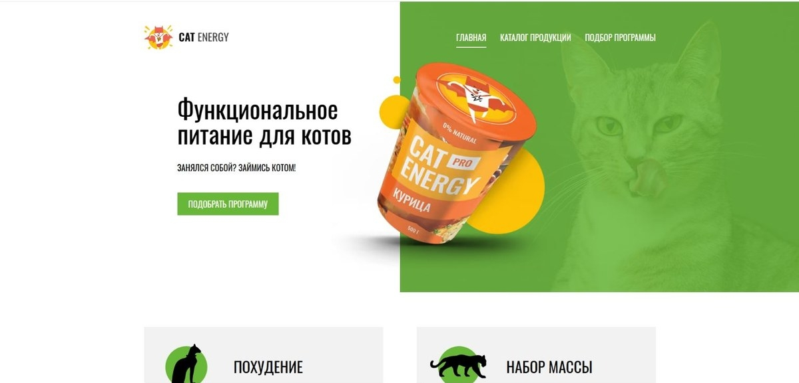
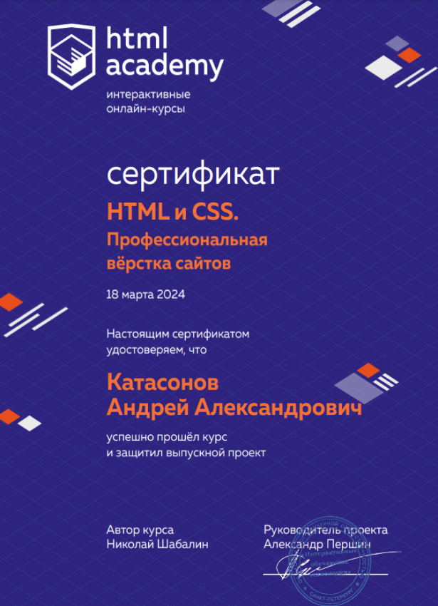
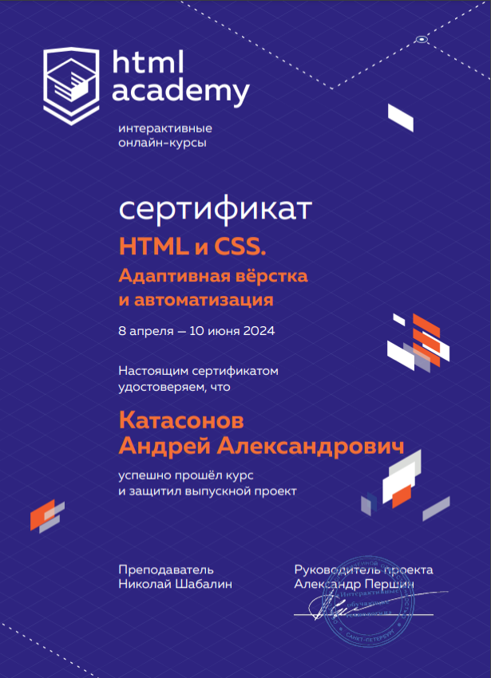
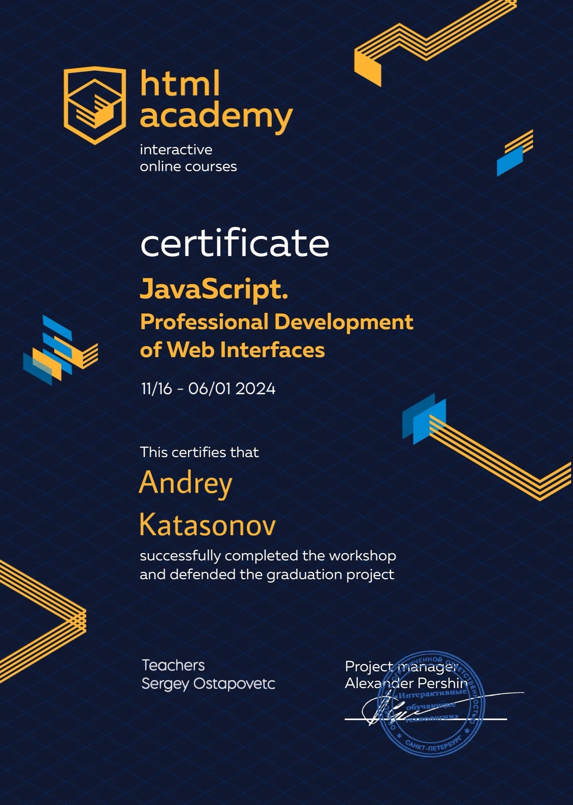
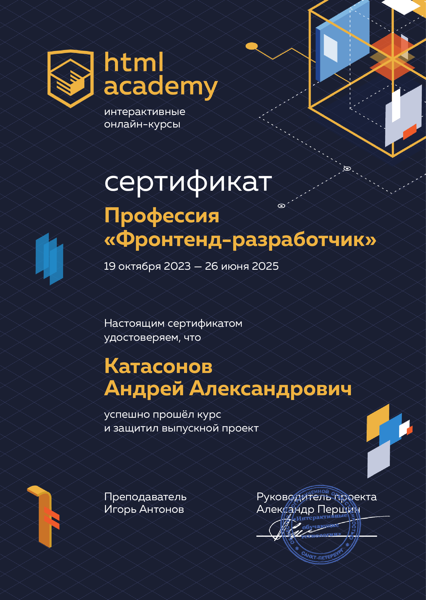

# 👋 Hi, I'm Andrey

### Frontend Developer

I build responsive and user-friendly web interfaces with HTML, CSS, SCSS and JavaScript.

I completed the Frontend Development program at HTML Academy and continue to improve my skills through practical projects. Currently, I'm deepening my JavaScript knowledge and learning React.

---

## 🛠️ Tech Stack

### Frontend

<table>
  <tr align="center">
    <td>
       
      HTML5
    </td>
    <td>
       
      CSS3
    </td>
    <td>
       
      Sass
    </td>
    <td>
       
      JavaScript
    </td>
    <td>
       
      React
    </td>
  </tr>
</table>

### Tools & Workflow

<table>
  <tr align="center">
    <td>
       
      Git
    </td>
    <td>
       
      GitHub
    </td>
    <td>
       
      VS Code
    </td>
    <td>
       
      Bash
    </td>
    <td>
       
      Node.js
    </td>
    <td>
       
      Gulp
    </td>
    <td>
       
      Vite
    </td>
    <td>
       
      npm
    </td>
  </tr>
</table>

---

## 🚀 Featured Projects

<table>
<tr>
<td width="50%" valign="top">

### 🐈 Cat Energy

Responsive website for a healthy nutrition brand.

**Highlights:** responsive layout, BEM methodology, Sass, JavaScript interactions.

**Stack:** HTML · SCSS · JavaScript · Gulp

[🌐 Live Demo](https://andeyak.github.io/Cat-energy/) · [📂 GitHub](https://github.com/AndeyAK/Cat-energy)

</td>
<td width="50%" valign="top">

### 🏞️ Sedona

Responsive website for a tourism destination.

**Highlights:** adaptive layouts and semantic page structure.

**Stack:** HTML · CSS · Responsive Design

[🌐 Live Demo](https://andeyak.github.io/Sedona-1/) · [📂 GitHub](https://github.com/AndeyAK/Sedona-1)

</td>
</tr>
<tr>

<td width="50%" valign="top">

### 📸 Kekstagram

JavaScript application focused on image handling and interactive UI elements.

**Stack:** HTML · CSS · JavaScript

[📂 GitHub](https://github.com/AndeyAK/2450769-kekstagram-2)

</td>
<td width="50%" valign="top">

### 🔬 Origin of Life

Personal experimental project exploring computational models of chemical reactions and the origin of life.

**Stack:** JavaScript · Scientific Modeling

[📂 GitHub](https://github.com/AndeyAK/OriginOfLife)

</td>
</tr>
</table>

---

## 🎓 Certificates

<table>
  <tr>
    <td align="center" width="25%">
      
       
      <b>HTML & CSS Professional</b>
    </td>
    <td align="center" width="25%">
      
       
      <b>HTML & CSS Adaptive</b>
    </td>
    <td align="center" width="25%">
      
       
      <b>JavaScript</b>
    </td>
    <td align="center" width="25%">
      
       
      <b>Frontend Developer</b>
    </td>
  </tr>
</table>
  
---

## 📚 Currently Learning

- Advanced JavaScript
- React
- Clean Code & Software Architecture
- Modern Frontend Development

---

## 🎯 Goals

- Strengthen my JavaScript and React skills.
- Build practical, maintainable web applications.
- Improve code quality and frontend architecture.
- Grow as a professional frontend developer.

---

## 📫 Contact

  
  

